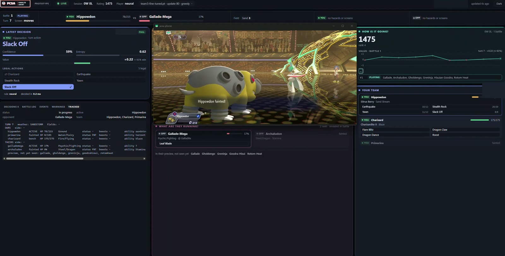
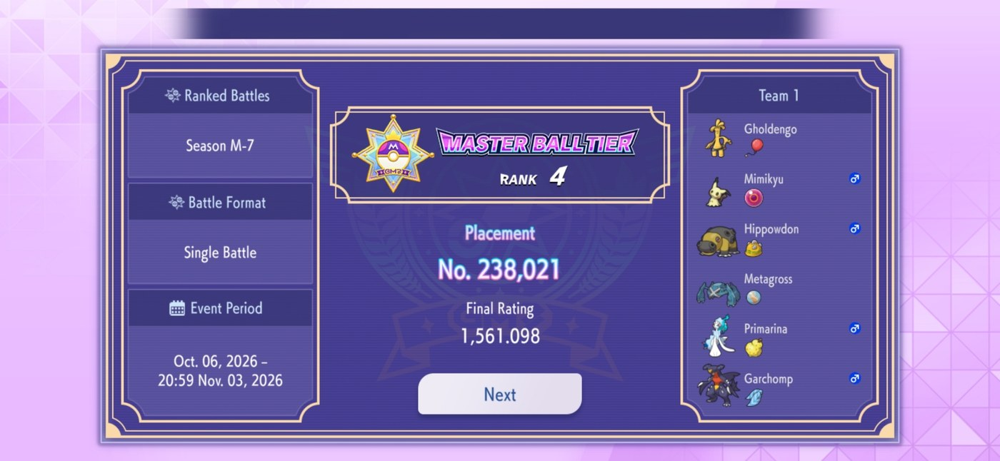

# pcsa

pcsa plays Pokémon Champions singles from the screen of a real phone. Everything it knows is read from
screenshots: text by OCR, Pokémon by a sprite network trained for this project, screens by a rule table. The
battle log is rebuilt as a Pokémon Showdown protocol so the agent holds the same battle state the Showdown
engine would, and the decision is made by one of the player kinds in `players/` from that tracked battle.
The Showdown engine doubles as the simulator the players are measured in.

> **Unofficial fan project**, not affiliated with or endorsed by Nintendo, The Pokémon Company, Creatures or
> GAME FREAK. Automated play on the live ranked ladder may break the game's terms of service, affects real
> players' matches and can get an account banned. Please run experiments in the simulator (`pcsa sim play`)
> rather than on the live ladder. Credits and licenses: `NOTICE.md`.

## Demo

[](https://www.youtube.com/watch?v=o6kFk4MY2VQ "Watch the demo on YouTube")

*Click the image to watch on YouTube (1:50): the neural player plays a ranked battle on the phone while `pcsa watch` shows each decision, its confidence, the critic's value and the tracked battle state (recorded with the first dashboard and network; the current ones are described below). Trainer names and session identifiers are blurred.*



*Season M-7, Single Battle: the account the agent played on finished in the Master Ball tier (trainer name and ID masked).*

## What is here

1. **Perception** (`phone/`): adb screenshots, OCR for text, the sprite network for Pokémon
   (`docs/sprites.md`; its trainer is `sprite_training/`, `pcsa train sprites`), and a rule table that names
   each screen.
2. **State reconstruction** (`battle/`): the battle log is read every turn and rebuilt as a Pokémon Showdown
   protocol, so the agent holds the same battle state the Showdown engine would.
3. **Decision** (`players/`): nine player kinds, all usable live and in the simulator: `random`, `simple_heuristic` (poke-env's numbers),
   `custom_heuristic` (the tuned `config/players/heuristic.yaml`), `max_damage` (the strongest attack, nothing
   else), `best_matchup_max_damage` (max_damage plus a switch out of a really bad matchup,
   `config/players/best_matchup.yaml`), `disciplined` (best_matchup plus damage-race rules for priority, Mega,
   replacements and switching, `config/players/disciplined.yaml`), `mixed` (a weighted pool of the others,
   one drawn per game, `config/players/mixed.yaml`), `endgame` (disciplined plus a 1v1 chain search once both
   sides are down to two members, `config/players/endgame.yaml`) and `neural` (a transformer policy
   trained by self-play in the research repo, `config/players/neural.yaml`, network code in `rl_training/`; see "Neural
   player" below).
4. **Simulator** (`sim/`): the Showdown engine as a local server, with its team validator, on which
   `pcsa sim play` plays games between the player kinds.
5. **Action** (`live/`): taps through a fixed menu map, and the session loop that plays battles (`pcsa run`).
   The interface is restricted by construction: there is no path to forfeiting, quitting, editing teams,
   purchases or rating dialogs.

`ARCHITECTURE.md` describes the packages. `docs/quirks.md` records what live play turned up and how each
issue was fixed, and the known defects of the battle-log reader.

## Scope and limitations

- **One device, one game version.** Everything was built on a single phone (the profile in
  `config/devices/`). Screen layouts, the menu map and the perception rules are tuned to that setup; another
  phone needs `pcsa calibrate` and will likely need fixes, and game updates can break the screen rules.
- **Singles only.** An opponent's hidden build is assumed (`players/opponent.py`): the first build of its species
  that fits what the battle has revealed, with the builds seen on the live ladder first and then the usage-ranked
  catalog. After every live battle each opposing set it revealed is either covered by the catalog or added to
  `assets/sets/seen_builds.json` (`pcsa sets learn` does the same for recorded runs). The simulator's teams use the
  catalog alone. The neural player's network is the exception: it is given only what the battle has revealed and
  predicts the opponent's action itself; only its guard rules and its fallback player use an assumed build.

**Requirements:** Windows 10/11 and an Android phone with Pokémon Champions and USB debugging on; an NVIDIA GPU
speeds up training the sprite network. Python, adb, scrcpy, the OCR models and the battle engine are installed for you.

## Setup

```
winget install astral-sh.uv                       # once per machine
git clone https://github.com/grichland/pcsa.git && cd pcsa
uv run pcsa setup --with sim --with train         # Python env, battle engine, torch, OCR models, output folder
```

`uv run pcsa doctor` repeats the checks without installing anything.

**Simulator** (no phone needed). Any two player kinds:

```
uv run pcsa sim play --a max_damage --b custom_heuristic --battles 100          # both teams from top builds
uv run pcsa sim play --a max_damage --b custom_heuristic --battles 100 --noisy  # both teams from any catalog build
```

Both sides' teams are drawn from the usage-ranked set catalog (`assets/sets/top_builds.json`): each species'
top build by default, with `--noisy` any of its catalog builds weighted by usage score.

Results land in `output/sim/<timestamp>-max_damage-vs-custom_heuristic-seed1/results.json` (`-noisy` appended with
`--noisy`) with a 95% Wilson interval. `max_damage` picks the attack the heuristic's damage estimate scores
highest and nothing else; `mixed` draws one member per game from `config/players/mixed.yaml`.

**Perception on a phone** (read-only: these commands capture the screen and send no input). With the phone
on USB (USB debugging on) and the game open:

```
uv run pcsa calibrate                # measures this phone once; writes config/devices/<model>.yaml
uv run pcsa observe                  # capture and classify the screen in a loop
uv run pcsa scout                    # record a manual walk through the game and report what changed
```

**Live play** (sends input to the phone). With the game open on the lobby:

```
uv run pcsa run --player custom_heuristic --battles 10
uv run pcsa nav --to lobby           # walk the menus to the lobby
```

`--player` takes a player kind (default: `policy.kind` in `config/agent.yaml`, `custom_heuristic`).

An action turn reads the battle log, decides, and taps Fight and the move row twice: it does not first open the
move list. It still looks at the move list on a turn that needs it (a move nearly out of PP by the log's count, a
log read that lost lines, taps that did not go through, an unconfirmed Mega). `timing.move_peek: always` in
`config/agent.yaml` looks before every turn instead.

For longer evaluation sessions, `scripts\run_agent.ps1` holds the settings (player, seed, run name,
overrides) at the top of the file, stops any agent left over from a run that ended abruptly, syncs the
environment, checks the phone and starts the run. With `$Mirror = $true` (the default) it also opens a phone
mirror window through [scrcpy](https://github.com/Genymobile/scrcpy), which `pcsa setup` installs into
`.tools\scrcpy\` (a `scrcpy` on PATH works as a fallback); when it is missing the script prints a warning and runs
without the mirror:

```
powershell -ExecutionPolicy Bypass -File scripts\run_agent.ps1 -Battles 25 -MaxBattlesTotal 30
```

**Dashboard.** `pcsa watch` serves a read-only page about a run on `http://127.0.0.1:8765/`, while the run plays
or after it has ended:

```
uv run pcsa watch                                             # the newest run under output\runs
uv run pcsa watch --run output\runs\<stamp>-run --port 8770   # a given run, another port; --no-browser to not open it
```

It has four panels. On the left, the newest saved phone frame, and under it the neural player's decision matrix:
the opponent's likeliest moves and their switches across the top (each with the probability the network gives it,
and a mark on moves they have already shown), our actions down the side, every cell shaded by how good our action
is against theirs (the score is printed in each cell), and our resulting policy as a bar per row. A score per row
is the row's cells weighted by their probabilities, which is what the network ranks our actions by; a "for them"
total per column says how each of their actions turns out for them over what we are likely to do. A control
(All / Top 5 / 3 / 2 / 1) recomputes the scores over only their most likely actions and says which action that
would pick, and a stepper ("trust in the prediction") reweights their probabilities at another opponent
temperature: both are what-ifs on the page, not changes to the player. The action played is written large with the win
chance (from the value, `(v + 1) / 2`), the chance they Mega Evolve and the decision time. Each new decision plays
once as a short animation: their columns, the cells, our row bars, then the chosen row. A guard-rule override
shows the rule and its reason and marks both the network's row and the row played; a decision the fallback player
made shows its reason in place of the matrix. On the right: the record, the win rate over the run and over the
last ten battles, the rating with one square per battle (click one to look at that battle) and the win-chance line
of the current battle; the two teams, ours in blue facing theirs in red, with only what the battle has revealed
about theirs and the field conditions between them; and the battle log by turn, which the run saves after every
visit to the log. Warnings open from the top bar. Runs recorded by the first network have no matrix and say so.
The page only reads the run folder (it never
touches the phone), is picked once at start (start it again for a later run) and listens on this computer only.
`scripts\run_agent.ps1` opens it next to a run (`$Watch = $true` at the top of the file, the default; set it to
`$false` to run without the page).

**Neural player.** `neural` plays a poke-singles-former checkpoint from the research runs (`research/pcsa-rl`:
`runs/<run>/ckpt/*.pt`; the model's size is read from the checkpoint). It needs torch (`uv sync --inexact --extra train`; `pcsa setup --with
train` installs it too) and runs on the CPU. Point it at a network with one override (or set `checkpoint` in
`config/players/neural.yaml`; relative paths are looked up in `$PCSA_NETWORKS`, then in the repo). Keep the
checkpoints in `assets/models/` (create the folder; its `.pt` files are not committed):

```
uv run pcsa sim play --a neural --b disciplined --battles 100 --set policy.neural_checkpoint=assets/models/poke-transformer-general-800.pt
uv run pcsa run --player neural --battles 10 --set policy.neural_checkpoint=assets/models/team2.pt
```

`poke-transformer-general-800.pt` is the general network (update 800 of the training run, any team); `team1.pt`,
`team2.pt` and `team3.pt` are the same network trained a little further with one of the account's three teams on
its side of every battle. `config/players/neural.yaml` names the one in use (match it to the team on the phone); `scripts\run_agent.ps1` runs the
neural player unless `$Player` is changed.


The network (`rl_training/former.py`, 1.8 M parameters: d 128, 4 layers, 4 heads) works in two steps: predict the
opponent, then choose.

- **Inputs.** Each of the 12 Pokémon (338 numbers plus species, item, ability and move embeddings), the field (126
  numbers) and what both sides did last turn become one token each: 14 tokens per decision. Nothing about the
  opponent is guessed: their rows hold only the moves, item and ability the battle has shown, and damage is given
  as a range over the builds they could have.
- **Memory.** Every token attends to its own decision's 14 tokens and to one stored token for each earlier
  decision of the battle (up to 64).
- **Their action.** One head gives a probability to every move their active Pokémon could use (anything its species
  can learn, plus anything it has shown) and to each of their bench members coming in, and separately the chance
  they Mega Evolve.
- **The matrix.** Their 4 most relevant moves (every move they have shown, then the most likely) and their 5 switch
  slots are the columns; our 11 actions (4 moves, the same 4 with Mega Evolution, 3 switches) are the rows. A cell
  scores our action against theirs. Each row is averaged over the columns, weighted by how likely each column is,
  and that gives the policy.
- **Value.** A third head estimates the outcome (+1 a win, −1 a loss); it also picks the three Pokémon to bring by
  scoring all 60 lead/second/third picks.

The matrix of every decision is written into the run's decision records, and the dashboard draws it.

Live play defaults to the most likely action (`sampling: greedy`; `sample` draws from training's capped 0.99
distribution) and training's team preview (the critic scores all 60 lead/second/third picks, softmax at 0.1,
top-p 0.9; `preview: greedy` takes the best). Whenever the network cannot decide (no or unreadable checkpoint,
a checkpoint of another network, no tracked Battle, an error, slower than `max_decision_s` or the turn deadline) the
`fallback` kind (`disciplined`) decides, and the decision's notes say why (`rule: neural:fallback`, `why`).

Two temperatures can be set for play without touching the checkpoint. `temperature` applies to `sampling: sample`
only: it multiplies the network's own policy temperature, so 2.0 draws from a flatter distribution (under `greedy`
it changes nothing, the top action stays the top action). `opponent_temperature` applies to the prediction of the
opponent's action where it weights the matrix: above 1 the choice hedges against their less likely actions, below
1 it trusts the favourite more, and this does change the action played under `greedy`. `neural.yaml` sets it a little above 1
(1.2 now; 1.3 is the value at which the prediction's confidence matches how often it was right on 295 recorded ladder battles
; as trained, 1.0, it was 48% sure of its top guess and right 38% of the time against real people); `temperature`
is 1.0. `opponent_top` weighs our options against only their N likeliest actions instead of all nine columns
(`neural.yaml`: 3; 0 is all of them, as trained). It was chosen from the dashboard's what-if on live games and
has not been measured in the simulator yet.

The network remembers a battle through one stored token per earlier decision. A same-turn retry replaces the last
decision instead of adding one, an answer that arrives too late leaves no trace, and a battle picked up again
after a restart gets its memory rebuilt from the run's saved decision records.

Four guard rules (`rules` in `config/players/neural.yaml`, on by default) stop plainly wasted actions: a heal at
full HP, a hazard already up or a status move on an already statused foe, a lock into moves that do nothing, and a
missed sure priority KO. The network's best other action is played and the notes say so (`override`,
`override_why`, `network`). The rules are the one place the neural player uses a guessed opposing build (the set
catalog, with builds seen on the ladder first); the network itself does not. `--set policy.neural_rules=none` plays the network alone.

## Where things go

| What | Where |
|---|---|
| Everything the agent writes (runs, frames, simulator results, sprite network training) | `output/` (override with `PCSA_OUTPUT`) |
| Every simulator battle (both teams, picks, winner, full protocol), one JSON line each | `output/sim/<stamp>/battles.jsonl.gz` |
| Installed tools (adb, scrcpy, OCR models, Node, Showdown) | `.tools/` (pinned in `tools.lock.json`) |
| Settings | `config/agent.yaml`, `config/screen.yaml`, `config/devices/*.yaml`; players: `config/players/heuristic.yaml`, `best_matchup.yaml`, `disciplined.yaml`, `mixed.yaml`, `endgame.yaml`, `neural.yaml` |
| Network checkpoints for the neural player | `assets/models/` (`.pt` files not committed; or any path, or `PCSA_NETWORKS`) |
| Game data, the sprite network (see `docs/sprites.md`), the simulator's set catalog | `assets/` |
| Opposing builds seen on the live ladder (grows after every live battle; ranked first when a build is assumed) | `assets/sets/seen_builds.json` |

## Development

```
uv sync --group dev
uv run poe check                     # ruff, pyright, import-linter, pytest
uv run pre-commit install
```

`pytest` skips the tests marked `torch` (needs the train extra) and `ocr` (runs the real OCR engine instead of
cached boxes); select them with `uv run pytest -m torch` or `-m ocr`.

Design: `ARCHITECTURE.md`. Live quirks, the runs that motivated them and the known reader defects:
`docs/quirks.md`. The sprite network: `docs/sprites.md`.

## Acknowledgements

- [championsbattledata.com](https://championsbattledata.com): the Pokémon Champions ranked-usage statistics
  that rank the simulator's set catalog.
- [Pokémon Showdown](https://github.com/smogon/pokemon-showdown) and [poke-env](https://github.com/hsahovic/poke-env):
  the battle engine, game data and battle model everything else is built on.

Full credits and licenses: `NOTICE.md`.
