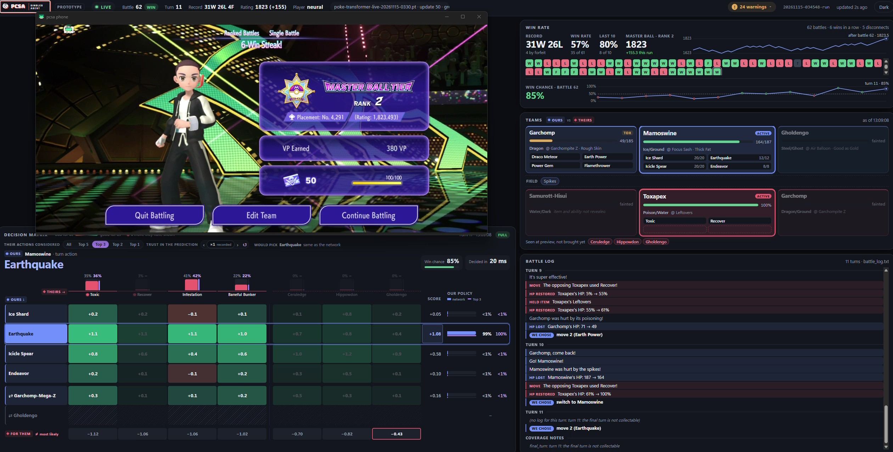

# pcsa

pcsa plays Pokémon Champions Ranked Singles from the screen of a real Android phone. It reads every screen from
screenshots (text by OCR, Pokémon by a small sprite network, screens by a rule table), sends each row of the
in-game battle log as an event to [Champions Gym](https://github.com/grichland/poke-champions-gym), and taps the
choice of a neural network trained by self-play in Champions Gym. Because Champions Gym tracks the battle on the
phone exactly as it does in training, the network sees the same inputs live as it learned from.

> **Unofficial fan project**, not affiliated with or endorsed by Nintendo, The Pokémon Company, Creatures or
> GAME FREAK. Automated play on the live ranked ladder may break the game's terms of service, affects other
> players' matches and can get an account banned. Prefer the simulator: Champions Gym plays games between its
> players without a phone. Credits and licenses: [NOTICE.md](NOTICE.md).

## Demo

[](https://www.youtube.com/watch?v=o6kFk4MY2VQ "Watch the demo on YouTube")

*The dashboard (`pcsa watch`) during a ranked session at Master Ball rank 2. The image links to a 1:50 video.*


*The game's result screen after a ranked win: Master Ball tier, rank 2, placement 2,489, rating 1,967.*

## How it works

```
phone screen ──adb──▶ perception ──log rows──▶ events ──LIVE events──▶ Champions Gym ──▶ neural network
     taps   ◀──adb── live play  ◀──────────────────── order ◀──────────────────────────────────┘
```

1. **Perception** (`phone/`): screenshots over adb, OCR, a sprite network for Pokémon, a rule table for screens.
2. **Events** (`battle/`, `events/`): each battle-log row becomes a Champions Gym LIVE event. Nothing the log
   does not show is invented.
3. **Decision** (`cg/`, `network/`): Champions Gym holds the battle, decides what is legal and runs the network.
   A late or failed answer falls back to a scripted player, so every turn is played.
4. **Action** (`live/`): taps through a fixed menu map. There is no code path to forfeiting, editing teams,
   purchases or rating dialogs.
5. **Records** (`run/`): every run keeps its frames, log rows, events and one record per decision; `pcsa watch`
   shows a run while it plays or afterwards.

## Quick start

Requirements: Windows 10 or 11 (x64) and an Android phone with Pokémon Champions and USB debugging on. Python,
Champions Gym, adb, scrcpy and the OCR models are installed by `pcsa setup`. The network runs on the CPU.

```
winget install astral-sh.uv
git clone https://github.com/grichland/pcsa.git && cd pcsa
uv run pcsa setup --with torch     # environment, Champions Gym, torch, adb, scrcpy, OCR models
uv run pcsa check                  # connect and name the current screen (no taps)
uv run pcsa run                    # play ranked battles from the lobby
uv run pcsa watch                  # the dashboard of the newest run
```

`scripts\run_agent.ps1` wraps a longer session: it checks the phone, opens a phone mirror and the dashboard,
and starts the run.

## Configuration

Every agent setting lives in [config/agent.yaml](config/agent.yaml), and nowhere else: the number of battles,
the run name and seed, the timeouts, the player, the checkpoint and the network's choice rule, rule masks and
search. Screen geometry is in `config/screen.yaml` and the phone's profile in `config/devices/`.
Change one for a single run with `--set section.key=value`, for example
`uv run pcsa run --set run.battles=25 --set cg.search.enabled=true`. Unknown or missing keys stop the run before
it starts. The full list is in [docs/configuration.md](docs/configuration.md).

## Documentation

| Topic | Where |
|---|---|
| Setup, phone commands and the session launcher | [docs/setup.md](docs/setup.md) |
| The neural player: network, choice rule, rule masks, search, checkpoints | [docs/neural-player.md](docs/neural-player.md) |
| The dashboard | [docs/dashboard.md](docs/dashboard.md) |
| Every setting | [docs/configuration.md](docs/configuration.md) |
| Packages, import rules, fallbacks, run records | [ARCHITECTURE.md](ARCHITECTURE.md) |
| Sprite recognition and its trainer | [docs/sprites.md](docs/sprites.md) |
| Checks, tests and tools | [docs/development.md](docs/development.md) |
| How the game behaves on the phone; everything its battle log has shown | [docs/reference/](docs/reference/) |

## Scope

- **One device, one game version.** Screen layouts and perception rules were built on one phone
  (`config/devices/`). Another phone needs `pcsa calibrate` and likely fixes; game updates can break screen rules.
- **Singles on Windows.** Champions Gym is released as a Windows x64 wheel for Python 3.12.
- **No simulator of its own.** Games without a phone are played in Champions Gym.

## Acknowledgements

- [Champions Gym](https://github.com/grichland/poke-champions-gym): the battle, the legal choices, the scripted
  players and the engine the network was trained on.
- [championsbattledata.com](https://championsbattledata.com): Pokémon Champions battle data and ranked usage.
- [Pokémon Showdown](https://github.com/smogon/pokemon-showdown): the source of the game data, here and in
  Champions Gym.

MIT License ([LICENSE](LICENSE)); full credits in [NOTICE.md](NOTICE.md).
