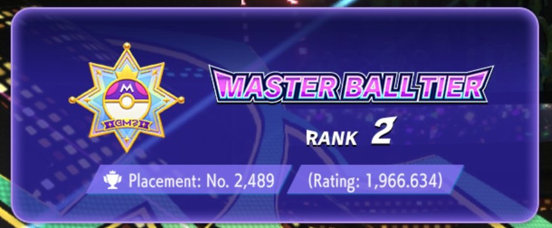

# pcsa

pcsa plays Pokémon Champions singles from the screen of a real phone. Everything it knows is read from
screenshots: text by OCR, Pokémon by a sprite network trained for this project, screens by a rule table. Each
row of the in-game battle log is sent as an event to [Champions Gym](https://github.com/grichland/poke-champions-gym)
(CG), a simulator of Pokémon Champions Ranked Singles. CG keeps the battle as a player sees it, decides which
choices are legal, and runs the player: by default a transformer policy trained by self-play on CG itself, so
the network sees the same battle on the phone as it did in training.

> **Unofficial fan project**, not affiliated with or endorsed by Nintendo, The Pokémon Company, Creatures or
> GAME FREAK. Automated play on the live ranked ladder may break the game's terms of service, affects real
> players' matches and can get an account banned. Please run experiments in a simulator (Champions Gym plays
> games between its players with no phone) rather than on the live ladder. Credits and licenses: `NOTICE.md`.

## Demo

[](https://www.youtube.com/watch?v=o6kFk4MY2VQ "Watch the demo on YouTube")

*`pcsa watch` during the 15 Nov 2026 live session, right after battle 62 (a 6-win streak at Master Ball rank 2, rating 1,823). The screenshot and the linked video (1:50) were recorded with the earlier version of this project, which tracked the battle with poke-env and Pokémon Showdown; the dashboard is the same page.*



*Single Battle, 15 Nov 2026: the post-game screen after one of the agent's ranked wins, also from the earlier version (Master Ball tier rank 2, placement No. 4,190, rating 1,825).*

## What is here

1. **Perception** (`phone/`): adb screenshots, OCR for text, the sprite network for Pokémon
   (`docs/sprites.md`; its trainer is `sprite_training/`, `pcsa train sprites`), and a rule table that names
   each screen.
2. **The battle log as events** (`battle/`, `events/`): the log panel is read every turn, each row is parsed,
   and the rows become CG's LIVE events (`enter`, `move`, `hp`, `faint`, `status`, `mega`, `weather`, ...).
   What the log never shows is never invented: there is no guessed item, set or critical hit.
3. **Tracking and decision** (`cg/`, `network/`): CG holds the Battle (both teams as revealed, the field, what
   is legal) and its neural player shell runs this repo's policy (`network/policy.py`) over a checkpoint in
   `assets/models/`. If the network cannot answer in time CG's scripted `tower` player decides; if CG does not
   answer at all the built-in `first` player takes the first legal choice, so a turn is never left unplayed.
4. **Action** (`live/`): taps through a fixed menu map, and the session loop that plays battles (`pcsa run`).
   The interface is restricted by construction: there is no path to forfeiting, quitting, editing teams,
   purchases or rating dialogs.
5. **Records and the dashboard** (`run/`): every run keeps its frames, log rows, events, CG messages and one
   record per decision; `pcsa watch` shows a run live or afterwards.

`ARCHITECTURE.md` describes the packages and the record format. `docs/quirks.md` records what live play turned
up and the known limits of the battle-log reader; `docs/battle-log.md` is a catalogue of everything the game's
log has shown in the recorded battles.

## Scope and limitations

- **One device, one game version.** Everything was built on a single phone (the profile in
  `config/devices/`). Screen layouts, the menu map and the perception rules are tuned to that setup; another
  phone needs `pcsa calibrate` and will likely need fixes, and game updates can break the screen rules.
- **Singles only, Windows only.** Champions Gym is released as a Windows x64 wheel for Python 3.12, and pcsa
  pins that release (0.4.0).
- **No simulator of its own.** Games without a phone are Champions Gym's job (`champions_gym.play_games`).

**Requirements:** Windows 10/11 (x64) and an Android phone with Pokémon Champions and USB debugging on.
Python, adb, scrcpy, the OCR models and Champions Gym are installed for you. The neural player runs on the CPU;
an NVIDIA GPU only speeds up training the sprite network.

## Setup

```
winget install astral-sh.uv                       # once per machine
git clone https://github.com/grichland/pcsa.git && cd pcsa
uv run pcsa setup --with torch                    # Python env, Champions Gym, torch, adb, scrcpy, OCR models, output folder
```

`uv run pcsa doctor` repeats the checks without installing anything. Without `--with torch` everything works
except the neural player and the sprite trainer (`--player first` plays the first legal choice, for testing
the phone side).

**Perception on a phone** (read-only: these commands capture the screen and send no input). With the phone
on USB (USB debugging on) and the game open:

```
uv run pcsa check                    # connect and name the current screen once
uv run pcsa calibrate                # measures this phone once; writes config/devices/<model>.yaml
uv run pcsa observe                  # capture and classify the screen in a loop
uv run pcsa scout                    # record a manual walk through the game and report what changed
```

**Live play** (sends input to the phone). With the game open on the lobby:

```
uv run pcsa run --battles 10
uv run pcsa nav --to lobby           # walk the menus to the lobby
```

`--player` takes `cg` (Champions Gym with the player set in `config/agent.yaml`, the default) or `first`.
`--resume <run folder>` continues a run. Any setting can be overridden for one run with
`--set section.key=value`.

An action turn reads the battle log, asks the player, and taps Fight and the move row twice: it does not first
open the move list. It still looks at the move list on a turn that needs it (a move nearly out of PP by the
log's count, a log read that lost lines, taps that did not go through, an unconfirmed Mega).
`timing.move_peek: always` in `config/agent.yaml` looks before every turn instead.

For longer sessions, `scripts\run_agent.ps1` holds the settings (battles, seed, run name, overrides) at the top
of the file, stops any agent left over from a run that ended abruptly, syncs the environment, checks the phone
and starts the run. With `$Mirror = $true` (the default) it also opens a phone mirror window through
[scrcpy](https://github.com/Genymobile/scrcpy), which `pcsa setup` installs into `.tools\scrcpy\`:

```
powershell -ExecutionPolicy Bypass -File scripts\run_agent.ps1 -Battles 25 -MaxBattlesTotal 30
```

**Dashboard.** `pcsa watch` serves a read-only page about a run on `http://127.0.0.1:8765/`, while the run plays
or after it has ended:

```
uv run pcsa watch                                             # the newest run under output\runs
uv run pcsa watch --run output\runs\<stamp>-run --port 8770   # a given run, another port; --no-browser to not open it
```

It has four panels. On the left, the newest saved phone frame, and under it the neural player's decision
matrix: the opponent's actions across the top (their revealed moves, one column for a move not yet seen, and
their switches, each with the probability the network gives it; with a checkpoint trained with belief slots the
moves not yet seen are named columns instead, underlined with dashes), our actions down the side, every cell shaded
by how good our action is against theirs (the score is printed in each cell), and our resulting policy as a bar
per row. A score per row is the row's cells weighted by their probabilities, which is what the network ranks
our actions by; a "for them" total per column says how each of their actions turns out for them. The network
scores a move and the same move with Mega Evolution as separate opponent actions; the page shows them as one
column and reports the Mega share as "They Mega". A control (All / Top 5 / 3 / 2 / 1) recomputes the scores
over only their most likely actions and says which action that would pick, and a stepper ("trust in the
prediction") reweights their probabilities at another temperature: both are what-ifs on the page, not changes
to the player. The action played is written large with the win chance (from the value, `(v + 1) / 2`) and the
decision time. A decision made by a fallback shows its reason in place of the matrix.

On the right: the record, the win rate over the run and over the last ten battles, the rating with one square
per battle (click one to look at that battle) and the win-chance line of the current battle; the two teams,
ours in blue facing theirs in red, with the field conditions between them; and the battle log by turn, which
the run saves after every visit to the log. HP is shown as a percentage on both sides, as Champions Gym holds
it. Warnings open from the top bar.

**What the network believes about their build.** Besides its decision the network has belief heads: for each
opposing Pokémon, how likely it was brought, how likely it leads, and its item, ability and moves. On an
opposing card, an item or ability the battle has not revealed is shown dimmed with the network's top guess and
its probability (the top three in the tooltip), and believed moves fill the empty move slots as dashed chips.
Members seen at team preview but not yet in battle show "brought N%", and "lead N%" during the preview. A
revealed fact always replaces the belief. The heads predict no nature or stat spread. They are auxiliary
training targets and do not enter the decision; they have only been checked on one replayed session of three
battles, so treat them as a view into the network, not as scouting.

The page only reads the run folder (it never touches the phone), is picked once at start (start it again for
a later run) and listens on this computer only. Runs recorded by the earlier version of this project open
with their record, rating, log and decisions; their teams, field and matrix are not shown.
`scripts\run_agent.ps1` opens the page next to a run (`$Watch = $true`, the default).

## Neural player

The player is Champions Gym's neural player shell with this repo's policy and network (`src/pcsa/network/`,
inference-only copies of the training code, each file naming its source). It needs torch
(`pcsa setup --with torch`) and runs on the CPU in its own process, started by `pcsa run` from the `cg` section
of `config/agent.yaml`. To play another checkpoint, change `checkpoint` there (a path relative to the repo, or
absolute). Checkpoints live in `assets/models/` and are committed with git:

| model | what it is | used by |
|---|---|---|
| `league-20261119-v-iter-00180-gold100.pt` | league run v, iteration 180, opponent head fitted to 100 live games | the live model (`config/agent.yaml`) |
| `league-20261119-v-iter-00180-gold100-labels.pt` | the same, then fitted to the reviewed ladder labels (report: the `.report.json` beside it) | not in use |
| `league-20261119-v-iter-00162.pt` | league run v, iteration 162 | the previous live model |
| `league-20261118-g-iter-00148.pt` | league run g, iteration 148 | the recorded session the tests replay (`tests/cg/`) |

A checkpoint stores the layout of its inputs; CG refuses one made for another layout or contract version
before the first battle, and the run does not start.

The network (`network/model.py`, about 1.6 M parameters: d 128, 4 layers, 4 heads) works in two steps:
predict the opponent, then choose.

- **Inputs.** The field, each of the 12 Pokémon and what happened last turn become one token each: 14 tokens
  per decision, laid out as Champions Gym's model contract defines them (the same arrays as in training).
  Nothing about the opponent is guessed: their rows hold only the moves, item and ability the battle has shown.
- **Memory.** A decision also sees the field and last-turn tokens of up to 32 earlier decisions of the battle.
  A battle picked up again after a restart gets its memory rebuilt by replaying the earlier requests.
- **Their action.** One head gives a probability to each of their 13 actions: the four move slots of their
  active Pokémon (revealed moves, and one slot standing for a move not yet seen), the same four with Mega
  Evolution, and their five possible switches. A checkpoint trained with `belief_slots` names each empty slot
  with the most likely move it has not shown, from the belief head and the species' learnset.
- **Rule masks.** As in training, a move used 4 turns in a row is closed while another move is open, and after
  3 switches by choice in a row switching is closed while a move is open. `policy_args` in `config/agent.yaml`
  takes `rule_masks` (false: off), `max_same_move` and `max_switches`.
- **Search (optional, off by default).** With `cg.search.enabled: true` in `config/agent.yaml` (or
  `--set cg.search.enabled=true` for one run) every turn request is also searched before it is answered. The
  player samples a few guesses of the opponent's hidden team from the belief head (6 by default), builds an engine
  game for each from the live Battle, and grows a tree per guess: both sides choose at once at every node, by
  regret matching started from the network's policy, its prediction of their action and its matrix; new positions
  are valued by the network. The action played is the one the search's strategy at the root favours most, inside
  the legal and rule masks. It stops at `cg.search.ms` (1500) or the request's deadline, whichever is sooner, and
  earlier when `cg.search.settle_sims` is set and the answer has settled: one action has led for that many
  simulations with `settle_share` of the strategy, or the best two are within `settle_gap` in value. A request
  with one open action is not searched, nor is a turn of the battle before `cg.search.from_turn`. The log read before the decision ends early enough to leave the search
  its time. When it cannot run or runs too little the network's own answer is played and the record says why. Team preview
  and replacements are never searched. It needs Champions Gym 0.5.0, which builds the engine game; with the pinned
  0.4.0 the setting only records that it could not run. On the dashboard a searched decision shows a Search figure
  (simulations, guesses, time), a SEARCH column with the search's share for each of our actions, a banner when
  it changed the pick, and a switch that redraws the matrix cells with the search's own values.
- **The matrix.** Our 11 actions (4 moves, the same 4 with Mega Evolution, 3 switches) are the rows and their
  13 actions the columns; a cell scores our action against theirs. Each row is averaged over the columns,
  weighted by how likely each column is, and a softmax over those scores gives the policy. No action gets more
  than 90% while another is possible.
- **Value.** A head estimates the outcome (+1 a win, −1 a loss). Another scores the 60 lead/second/third picks
  at team preview.
- **Belief.** The heads described above under the dashboard.

Live play takes the most likely action. The matrix, the prediction, the policy, the value and the belief of
every decision are written into the run's decision records, and the dashboard draws them.

## Where things go

| What | Where |
|---|---|
| Everything the agent writes (runs, frames, sprite network training) | `output/` (override with `PCSA_OUTPUT`) |
| One run: manifest, events, frames, and per battle the log, the LIVE events, the CG messages and one record per decision | `output/runs/<stamp>-<name>/` |
| Installed tools (adb, scrcpy, OCR models) | `.tools/` (pinned in `tools.lock.json`) |
| Settings | `config/agent.yaml`, `config/screen.yaml`, `config/devices/*.yaml` |
| Network checkpoints for the neural player | `assets/models/` |
| Game data, Champions Gym's tables and id numbering, the sprite network (see `docs/sprites.md`) | `assets/` |
| Usage-ranked builds and the opposing builds met on the ladder (data only; nothing reads them at run time) | `assets/sets/` |

## Development

```
uv sync --group dev --extra torch
uv run poe check                     # ruff, pyright, import-linter, pytest
```

`pytest` skips the tests marked `torch` (the sprite trainer's end-to-end run) and `ocr` (the real OCR engine
instead of cached boxes); select them with `uv run pytest -m torch` or `-m ocr`. The tests of the Champions Gym
side, including a replay of a recorded ranked battle through the neural player, run by default and need the
Champions Gym wheel, so they run on Windows only.

`uv run python tools\replay_run.py <run folder>` replays a run's saved Champions Gym messages through the
player, with no phone, and writes a copy of the run with fresh decision records: a way to check a change to
the player against recorded battles, and to look at an old session with a new checkpoint on the dashboard.

Design: `ARCHITECTURE.md`. Live quirks and the known limits of the log reader: `docs/quirks.md`. The sprite
network: `docs/sprites.md`.

## Acknowledgements

- [Champions Gym](https://github.com/grichland/poke-champions-gym): the battle, the legal choices, the players
  and the engine the network was trained on.
- [championsbattledata.com](https://championsbattledata.com): the Pokémon Champions battle data and ranked-usage
  statistics.
- [Pokémon Showdown](https://github.com/smogon/pokemon-showdown): the source of the game data, here and in
  Champions Gym.

Full credits and licenses: `NOTICE.md`.
